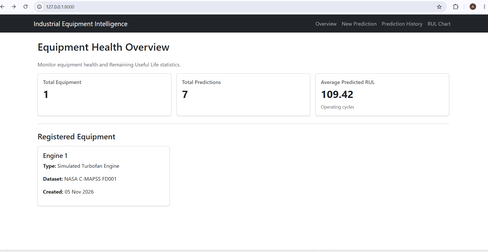
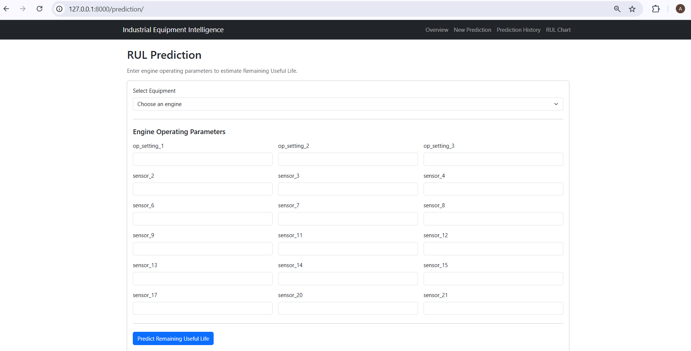
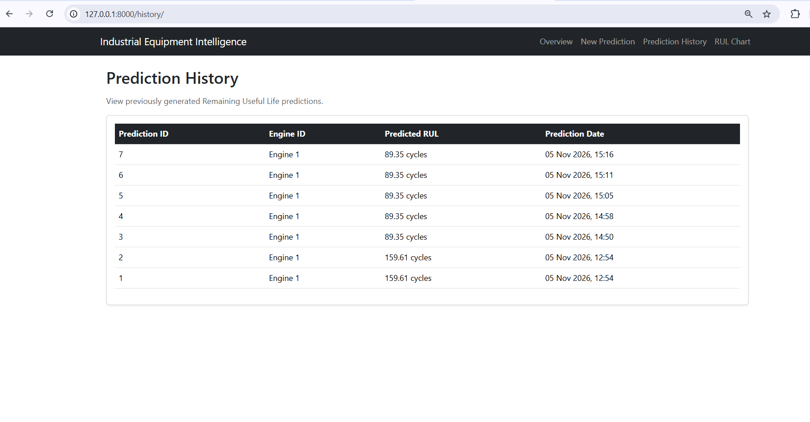
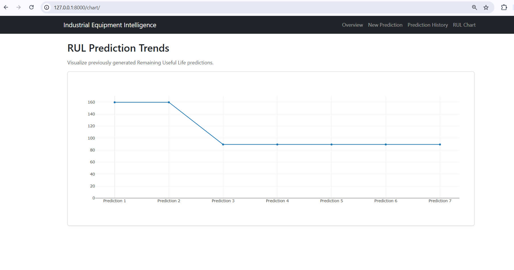

# Industrial Equipment Intelligence

An ML-powered predictive maintenance platform that estimates the Remaining Useful Life (RUL) of simulated industrial turbofan engines using historical sensor data.

## Project Overview

Industrial Equipment Intelligence uses machine learning to estimate how many operating cycles remain before a simulated turbofan engine reaches its end-of-life point.

The project uses the NASA C-MAPSS FD001 dataset and a Random Forest Regression model to predict Remaining Useful Life (RUL) from 18 operating-condition and sensor features.

The predictions are integrated into a Django web application where users can submit engine readings, view predicted RUL, review prediction history, and explore prediction trends through interactive charts.

**Note:** This is a machine learning portfolio prototype based on simulated turbofan engine data, not a live industrial monitoring system.

## Key Features

**Remaining Useful Life Prediction:** Estimates the number of operating cycles remaining for a simulated turbofan engine.
**Machine Learning Model:** Uses a Random Forest Regressor trained on NASA C-MAPSS FD001 data.
**Feature Validation:** Validates all 18 input features before generating predictions.
**REST API:** Provides a Django REST Framework endpoint for submitting sensor readings and receiving predictions.
**Interactive Dashboard:** Displays equipment information and prediction statistics.
**Prediction History:** Stores and displays previously generated predictions.
**RUL Trend Visualization:** Uses Plotly to visualize prediction trends.
**PostgreSQL Database:** Stores equipment records and prediction history.
**Automated Testing:** Includes Django tests for equipment, prediction API, and dashboard functionality.


## Technology Stack

### Backend
- Python
- Django
- Django REST Framework
- PostgreSQL

### Machine Learning
- Scikit-learn
- Pandas
- NumPy
- Joblib

### Frontend
- HTML
- CSS
- JavaScript
- Bootstrap 5
- Plotly

### Testing and Development
- Django Test Framework
- Git
- GitHub
- VS Code

## Dataset

This project uses the **NASA C-MAPSS FD001** dataset, which contains simulated turbofan engine degradation data.

- Training dataset: 100 simulated engines.
- Test dataset: 100 simulated engines.
- Input features: 18 operating-condition and sensor features.
- Prediction target: Remaining Useful Life (RUL).
- RUL unit: Operating cycles.

The dataset is used to train and evaluate the model on simulated engine degradation patterns.

## Machine Learning Model

- Algorithm: Random Forest Regressor
- Number of estimators: 100
- Maximum depth: 12
- Random state: 42
- Task: Regression

The model takes 18 input features and predicts the estimated Remaining Useful Life in operating cycles.

### Model Evaluation

The model was evaluated using a separate official NASA FD001 test dataset.

| Evaluation Metric | Result |
|---|---:|
| Mean Absolute Error (MAE) | 24.55 cycles |
| Root Mean Squared Error (RMSE) | 32.90 cycles |

The validation and test evaluations are performed separately to assess model performance.

**Limitation:** The model is trained specifically on NASA C-MAPSS FD001 simulated turbofan data. Its predictions should not be assumed to generalize to other equipment types without suitable data, retraining, and validation.

## Project Architecture

The application follows a modular monolithic architecture using Django.

```text
Industrial Equipment Intelligence
│
├── config/          # Django project configuration
├── equipment/       # Equipment management
├── predictions/     # Prediction API and prediction records
├── monitoring/      # Dashboard and visualizations
├── maintenance/     # Maintenance app
├── ml/              # ML prediction logic
├── models/          # Trained model and metadata
├── data/             # Dataset files
├── templates/        # HTML templates
├── train_model.py    # Model training and evaluation
└── prepare_data.py   # Dataset preprocessing


## API Documentation

### Generate RUL Prediction

- **Endpoint:** `/api/predictions/`
- **Method:** `POST`
- **Content-Type:** `application/json`

The API accepts an engine ID and 18 sensor/operating-condition features.

**Request structure:**

```json
{
  "engine_id": 1,
  "features": {
    "op_setting_1": 0.0,
    "op_setting_2": 0.0,
    "op_setting_3": 100.0
  }
}

## Installation and Setup

### 1. Clone the Repository

git clone https://github.com/MAfreen3502/Industrial-equipment-intelligence.git

cd Industrial-equipment-intelligence

### 2. Create Virtual Environment

python -m venv .venv

.venvScriptsActivate.ps1

### 3. Install Dependencies

pip install -r requirements.txt

### 4. Configure Environment

Create a `.env` file using `.env.example` and configure your PostgreSQL database credentials.

### 5. Run Migrations

python manage.py migrate

### 6. Start the Server

python manage.py runserver

Open http://127.0.0.1:8000/ in your browser.

### 7. Run Tests

python manage.py test

## Application screenshots

### 1. Overview Dashboard



### 2.New Prediction



### 3. Prediction History



### 4. RUL Chart



